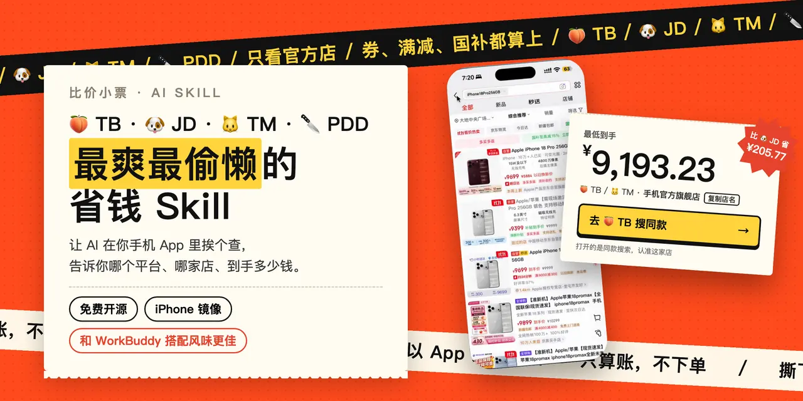
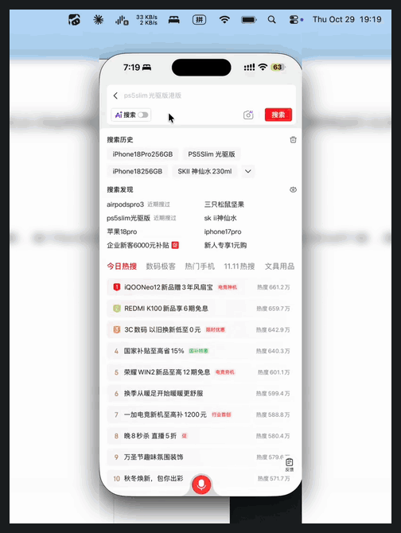
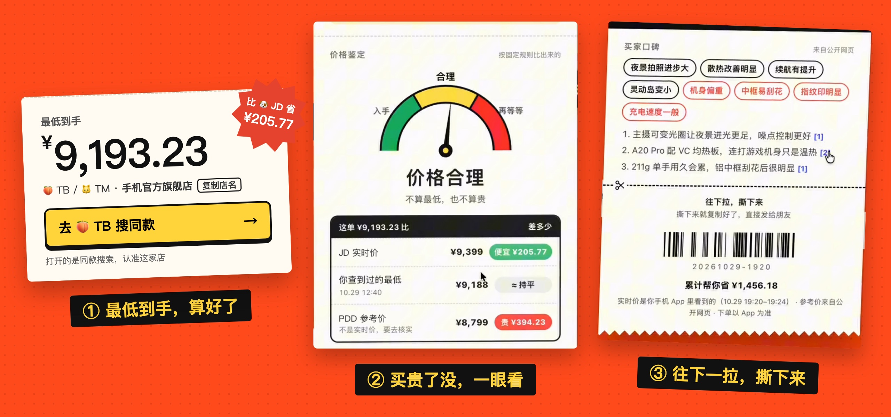
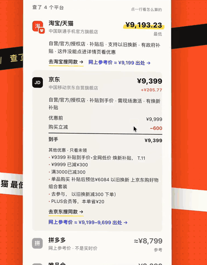

<p align="center">
  
</p>

<h1 align="center">🍑 TB · 🐶 JD · 🐱 TM · 🔪 PDD<br>最爽最偷懒的省钱 Skill</h1>

<p align="center"><b>让 AI 在你手机 App 里挨个查价，告诉你哪个平台、哪家店、到手多少钱。</b></p>

<p align="center">由小红书科技博主 <a href="https://www.xiaohongshu.com/user/profile/5faedce8000000000101c8a3"><b>蜗牛的科技笔记</b></a> 在 WorkBuddy 上做出来的。免费、开源，<b>和 WorkBuddy 搭配风味更佳</b>。</p>

<p align="center">
  <a href="#三步用起来">安装</a> ·
  <a href="#它能帮你做什么">能做什么</a> ·
  <a href="#只算账不下单">安全吗</a> ·
  <a href="#问答">问答</a> ·
  <a href="CHANGELOG.md">更新记录</a>
</p>

<p align="center">
  
  
  
  <a href="LICENSE"></a>
  <a href="https://github.com/woniuniuniu/tb-jd-tm-pdd-saver-skill/stargazers"></a>
</p>

<br>

## 它是什么

双十一的套路越来越多：定金尾款、凑单满减、平台券、店铺券、国补……同一个东西，三个平台三个价，算都算不明白。

这个 Skill 让你的 AI 助手**直接操作你的手机**：用 Mac 的「iPhone 镜像」打开 🍑 TB、🐶 JD、🔪 PDD 三个 App（🐱 TM 的店在 🍑 TB 里一起看），搜你要的东西，**只看官方旗舰店和自营店**，再一件件点进商品页，把券、满减、国补都算进去。最后交给你一张**比价小票**：哪个平台、哪家店、到手多少钱，一目了然。

你只要说一句话，然后把电脑放旁边，去做自己的事。

<br>

## 三步用起来

<table>
<tr>
<td valign="top" width="52%">

**① 装上**

把这个仓库的链接发给 WorkBuddy，跟它说「帮我安装这个 skill」。

```
https://github.com/woniuniuniu/tb-jd-tm-pdd-saver-skill
```

**② 连好手机**

按 WorkBuddy 说的，打开 Mac 上的「iPhone 镜像」，连好电脑和手机。手机上装好 🍑 TB、🐶 JD、🔪 PDD 三个 App。

**③ 说一句话，有两种用法**

🛒 **看购物车**：已经加进购物车的，让它帮你挨个核一遍。

> 看看我购物车前 3 件商品，double check 一下，看有没有更便宜的买法

🔍 **说你想买什么**：还没加购的，直接告诉它，它自己去三个平台搜。

> 我想买 iPhone 18 Pro 256GB，帮我看看哪里最便宜

说完就不用管了，把电脑放旁边去做你自己的事。它会开始疯狂工作，跑个几分钟，小票就出来了。

</td>
<td valign="top">
  
  <p align="center"><sub>真实录屏：AI 在电脑上通过 iPhone 镜像操作你的手机</sub></p>
</td>
</tr>
</table>

<br>

## 一张小票，说清楚在哪买

<p align="center">
  
</p>

<table>
<tr>
<td valign="top" width="58%">

**最低到手，算好了。** 每个平台的官方店价格都列出来，点开能看到「优惠前 → 每一项优惠 → 到手价」。最便宜的那家放最大，旁边贴着比别处省了多少。

**买贵了没，一眼看。** 一个表盘告诉你「入手 / 合理 / 再等等」，下面是和其他平台实时价、网上参考价、你查到过的最低价的对比。

**还有买家口碑。** 联网搜一波大家夸什么、吐槽什么，每一条都带出处。

**点「出处」，直接去下单。** 小票里的链接直接跳到对应平台。

**往下一拉，撕下来。** 按住虚线往下拉，纯文字版的小票就复制好了，一键发给朋友。

</td>
<td valign="top">
  
  <p align="center"><sub>真实录屏</sub></p>
</td>
</tr>
</table>

<br>

## 它能帮你做什么

| | 你说 | 它做 |
| :---: | :--- | :--- |
| 🛒 | 「看看我购物车前 3 件，有没有更便宜的买法」 | **购物车体检**：读 🍑 TB 或 🐶 JD 购物车，挨个点进商品页看到手价，再去另外两个平台找同款 |
| 🔍 | 「iPhone 18 Pro 256GB 哪里便宜」 | **单品比价**：🐶 JD、🍑 TB、🔪 PDD 依次查，出比价表和小票 |
| ⏰ | 「这个降到 8,999 叫我」 | **盯价提醒**：每天定时查，到价了提醒你 |
| 📅 | 「把双十一开抢时间加到日历」 | **抢购日历**：做成日历文件，双击导入 |
| 🎆 | 「我一共省了多少钱」 | **彩蛋**：省钱战报、14 个成就（4 个隐藏）、烟花，嫌吵可以关 |

<br>

## 只算账，不下单

- **只看，不动手**：从不下单、加购、领券、结算、支付、登录。商品页里的券只看不领，购物车里不勾选、不改数量。
- **只认官方店**：只比品牌官方旗舰店和平台自营（🔪 PDD 只认品牌官方旗舰店和平台自营），代购、海外版、港版、专营店、二手都不算。
- **价格都来自你自己的手机**：结论里只用你手机 App 上看到的实时价。网上的参考价单独列出、标明出处，只用来提醒你「别处可能更便宜，去核实一下」。
- **所有下单、支付都是你自己来**。

<br>

## 需要什么

| 准备 | 要求 |
| :--- | :--- |
| **电脑** | macOS 15 以上的 Mac，能用「iPhone 镜像」 |
| **手机** | iPhone，装好 🍑 TB / 🐶 JD / 🔪 PDD App |
| **AI 助手** | 推荐 WorkBuddy；其他能读 Skill、能运行命令的助手也行（有联网搜索时会多一份参考价和口碑） |
| **运行环境** | Python 3（只用自带的库，不用另装东西）；装了 Xcode 命令行工具会更快、更稳 |

不用 WorkBuddy 的话，把整个文件夹放进你的 AI 助手的 skills 目录就行。

<br>

## 问答

**要花钱吗？**
Skill 免费。AI 助手本身调用模型的费用按你用的助手算。

**跑一次要多久？**
一个平台大约 1～3 分钟，三个平台加上网上参考价，一般几分钟到十几分钟。期间别碰手机、鼠标和 iPhone 镜像窗口。

**保证是全网最低吗？**
不保证。它看的是每个平台搜索结果的前五屏，结论是「这次在你手机上看到的最低价」。下单以 App 为准。

**为什么只看官方店？**
怕你买到假货、水货、港版。省钱的前提是买对东西。

**App 改版之后不好用了？**
欢迎提 [Issue](https://github.com/woniuniuniu/tb-jd-tm-pdd-saver-skill/issues) 或 PR。每个版本改了什么、踩过哪些坑，都写在 [更新记录](CHANGELOG.md) 里。

<br>

## 文件

```text
tb-jd-tm-pdd-saver-skill
├─ SKILL.md            # 给 AI 助手看的操作说明
├─ CHANGELOG.md        # 每个版本改了什么、踩过的坑
└─ scripts/
   ├─ yijian.py        # 一键比价入口
   ├─ zidong.py        # 在手机 App 里搜索、读价格、进商品页看优惠
   ├─ jingxiang.py     # 截 iPhone 镜像窗口、认字、点击、输入
   ├─ jietu.swift      # 用录屏流截图（可选，更快）
   ├─ huizong.py       # 合并结果、过滤同款、算到手价
   ├─ xiaopiao.py      # 生成比价小票网页
   ├─ gouwuche.py      # 购物车体检
   ├─ dingjia.py       # 定时盯价
   ├─ tixing.py        # 到价提醒
   ├─ rili.py          # 抢购日历
   └─ caidan.py        # 战报、成就、烟花
```

> 装进 WorkBuddy 后，它自称「蜗牛最爽省钱 Skill」，就是这一个。

<br>

## 许可

[MIT](LICENSE)。随便用、随便改，觉得好用就点个 ⭐。

<p align="center"><sub>现在有 AI 了，我们就可以用 AI 工具进行魔法对轰。爽薅双十一最后一波羊毛！</sub></p>
